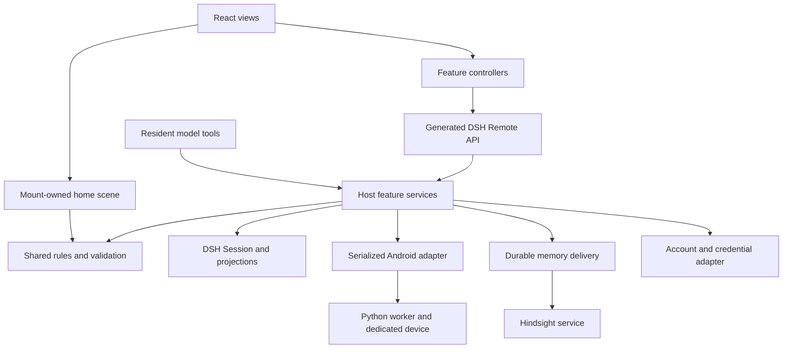

# Virtual Live architecture proposal

Status: partially applied. The arrangement decision is extracted into a pure
`src/domain/home/arrangement.ts` planner and a synchronous
`src/host/resident/arrangement.ts` host adapter. The remaining target paths are
proposals.

Reviewed source: [B143KC47/dsh-virtuallive at
4a3098eb148507e3a66ec39d9ed5cc432c410ccb](https://github.com/B143KC47/dsh-virtuallive/tree/4a3098eb148507e3a66ec39d9ed5cc432c410ccb).
Review date: 2026-11-05.

## 1. Decision

Keep **one modular DSH plugin**, with a shared deterministic domain, explicit
host services, browser feature modules, and narrow adapters for external
effects. Keep the existing DSH Agent, Session, projection, typed Remote,
credential, and subprocess mechanisms.

A modular plugin means features have clear owners and import rules while
remaining one package and one host deployment. It does not require each
feature to become a separate server or npm package. Android already has a
Python process boundary; Hindsight already has a service boundary.

The first engineering milestone is a reproducible compatible Harness fixture.
Directory changes follow that milestone. The strongest objection to this
proposal is that many intended boundaries already exist in code. That is
correct: enforce and clarify them before paying for broad file movement.

### Assumptions

- One configured resident/session is owned by one host service instance.
- The product continues to run inside DSH. Independent distribution is a
  possible later requirement, not a capability established by this review.
- Existing user history, remote interfaces, and generated exports matter.
- Phone and memory integrations stay optional.
- No measured scaling or rendering result currently justifies distributed
  workers, a new database, a new rendering engine, or a second agent framework.

If multi-tenant hosting or multiple processes writing one resident become
requirements, revisit ownership, authorization, and storage concurrency.

## 2. What exists and what needs work

The audited revision contained 55 TypeScript/TSX source files (about 6,016
lines) and 23 test files (about 2,457 lines). Counts exclude artwork and Python.
This tree adds the guidance and the arrangement extraction; it still has no
local lockfile or CI workflow. These are inventory facts, not a quality score.

| Finding | Status and consequence |
| --- | --- |
| The package uses workspace dependencies, ancestor TypeScript configs, a sibling bundler helper, and sibling test fixtures. | Confirmed. A standalone clone is not a self-contained development environment. |
| `state.ts` folds validated Session events into resident state. | Existing strength. Preserve replay and separate DSH decoding from a pure reducer only when it helps testing or dependency control. |
| `home-arrangement.ts` serves GUI and model edits with revision and collision checks. | Existing strength. Keep one write path. |
| Geometry, camera calibration, and furniture metadata are shared with rendering. | Existing strength. Preserve one authoritative catalog. |
| React receives controller faces; scene resources have a mount owner. | Existing strength. Organize features without replacing that model. |
| The phone service serializes actions and preserves uncertain outcomes. | Existing strength. Do not add generic automatic mutation retries. |
| Memory already has stable IDs, a durable pending queue, flush-before-send, and status-before-submit. | Existing strength. Improve policy and test seams rather than replacing its queue. |
| Memory processes only the queue head; terminal failures remain at the head. | Confirmed behavior. Define a blocked-entry policy before increasing autonomous activity. |
| Memory pending content has no aggregate bound and checkpoints contain full state. | Confirmed structure. Large backlogs need an explicit capacity and persistence policy. No capacity benchmark was run. |
| Phone requests have no expected observation version. | Confirmed contract. Concurrent callers using an old screen are an inferred risk; no such failure was reproduced here. |
| The Home editor repeats room bounds as 10 and 8. | Confirmed duplication. Values currently agree with shared geometry; this is not a demonstrated present bug. |
| The Home UI test mocks `Room`. | Confirmed test scope. It does not verify canvas/WebGL or scene cleanup. |

Evidence: [package and configs](../package.json), [projection](../src/state.ts),
[arrangement writes](../src/home-arrangement.ts), [phone service](../src/phone.ts),
[memory delivery](../src/memory.ts), [memory state](../src/memory-state.ts),
[Home controller](../src/client/controller.ts), [scene](../src/client/home-scene.ts),
[editor](../src/client/HomeLayers.tsx), [Home test](../tests/home.client.spec.tsx).

## 3. Runtime ownership

This diagram shows responsibility and call paths, not separate deployments.
The target preserves the current single resident Agent and Session.



| Owner | Owns | Must not own |
| --- | --- | --- |
| Resident lifetime service | Agent activation, session binding, shutdown, notifications | Geometry implementation or graphics resources |
| Resident commands | Validation, current-state read, event decision, protected append | HTTP, Python protocol, React |
| Resident projection | Event decoding and deterministic state reconstruction | Timers, external effects, invented events |
| Phone service | Shared queue, observation state, uncertainty gate, worker lifetime | Persona authority or account credentials |
| Memory service | Binding, durable backlog, delivery supervision, readiness | An independent authoritative conversation store |
| Connections service | Account linking and credential verification | Android app login or implied publishing permission |
| Client controller | Remote subscription and request lifecycle | Authoritative resident state |
| React view | Local forms and display | Session writes or raw subprocess/network ownership |
| Home scene | Assets, drawing, picking, animation, DOM/GPU cleanup | Device actions or invented durable movement |

## 4. Target source layout

These are target paths. Create or move modules incrementally; do not create
empty directories or interface files merely to match this list.

| Path | Responsibility |
| --- | --- |
| `src/index.ts` | Stable public host entry and composition |
| `src/types.ts` | Stable public type facade and compatibility re-exports |
| `src/contracts/` | Browser-safe wire DTOs for resident, phone, memory, connections |
| `src/domain/resident/` | Resident types, schemas, pure reducer, persona assembly |
| `src/domain/home/` | Home types, schemas, camera, catalog, geometry, interaction and arrangement planning |
| `src/host/resident/` | DSH service, command execution, Session event adaptation, projection registration, resident/furniture tools |
| `src/host/phone/` | Phone service, worker client, wire protocol, tool adapter |
| `src/host/memory/` | Memory service, host projection, delivery loop, transport, managed processes, tool adapter |
| `src/host/connections/` | Connection service and Bilibili provider |
| `src/client/index.ts` | Stable public browser entry |
| `src/client/app/` | Cross-feature mounting, route/sidebar/workspace integration |
| `src/client/features/home/` | Home view, editor, React Room mount, conversation mode, controller, locales/styles |
| `src/client/features/phone/` | Phone view, page, controller, locales/styles |
| `src/client/features/memory/` | Memory status card, locales/styles |
| `src/client/features/connections/` | Account settings view, controller, locales/styles |
| `src/client/scene/` | Scene instance, frame scheduling, furniture drawing/picking; no React wrapper |
| `src/client/scene/resident/` | Skeleton, motion, registration, sprite and graphics surface |
| `src/client/assets/` | Existing browser assets, retained at their bundler-supported path |
| `assets/` | Existing Python worker and artwork provenance manifest |
| `tests/` | Existing tests; regroup only when it improves ownership and preserves fixture paths |

### Import rules

| Area | Allowed dependencies | Excluded dependencies |
| --- | --- | --- |
| Domain | Domain types/data, pure validation libraries | Host, client, DSH runtime services, Node I/O, DOM, React, HTTP, subprocesses |
| Contracts | Domain types and small wire schemas; explicit type-only host brands where needed for compatibility | Host implementations, credential values, rendering objects |
| Host feature | Domain, contracts, its own implementation, required DSH APIs | Browser code; another feature's private worker/transport |
| Client feature | Contracts, domain, browser APIs, its own controller and views | Host code, Node built-ins, worker processes, credential storage |
| Client scene | Domain, rendering types/assets, browser graphics APIs | Remote transport, host code, account services |
| Composition entries | Public feature interfaces and platform registration | New domain rules hidden inside bootstrap code |

Do not use a root barrel that re-exports host implementations to the browser.
Type-only imports still count as architectural coupling, even when they
disappear from runtime JavaScript. Runtime cycles and type-only cycles must
be reported separately.

Use the selected Harness's TypeScript-aware lint/analysis tooling to enforce
these import rules after the baseline is reproducible. Check static imports,
re-exports, dynamic imports with literal paths, and package aliases. Check the
browser bundle as well. The delivered preflight checks setup only; it is not
an architecture linter.

### Migration map

| Current source | Target | Compatibility note |
| --- | --- | --- |
| `index.ts` | Thin entry plus `host/resident/service.ts` | Preserve default export, service name, decorators, and generated Remote identity. |
| `types.ts` | Domain types, wire contracts, DSH augmentation adapter | Keep the public facade; avoid duplicate definitions. |
| `state.ts` | Domain schemas/reducer plus `host/resident/projection.ts` | Preserve event parsers, including legacy journey fields, and projection key/version semantics. |
| `persona.ts` | `domain/resident/persona.ts` | Preserve current input behavior during a move. |
| `home-camera.ts`, `home-catalog.ts`, `home-space.ts` | `domain/home/` | Keep one catalog for geometry and authored visual registration. |
| `home-interaction.ts` | `domain/home/interaction.ts` | It is browser-neutral computation, even where it returns illustration coordinates. |
| `home-arrangement.ts` | `domain/home/arrangement.ts` plus `host/resident/arrangement.ts`; the old path remains a compatibility facade | Do not insert an asynchronous gap between revision validation and append. |
| `resident-tools.ts`, `furniture-tools.ts` | `host/resident/` | Model tools and GUI call the same command rules. |
| `phone-types.ts`, `memory-types.ts`, `connections-types.ts` | `contracts/` plus required DSH augmentations in host | Keep existing type exports during transition. |
| `phone.ts`, `phone-worker.ts`, `phone-protocol.ts`, `phone-tools.ts` | `host/phone/` | Preserve queue and uncertainty; verify Python asset resolution in source and packaged output. |
| `memory.ts` | `host/memory/service.ts`, then extract delivery/tools only as useful | Separate responsibilities one at a time; do not replace the outbox. |
| `memory-state.ts` | `host/memory/projection.ts` initially | It imports `node:crypto`; it is not browser-safe. |
| `memory-transport.ts`, `memory-server.ts`, `memory-worker.ts` | `host/memory/` | Preserve managed-process shutdown and environment handling. |
| `connections.ts`, `bilibili-connection.ts` | `host/connections/` | Existing provider injection is already useful. |
| Client view/controller/locale groups | Corresponding client feature | Keep observable/action faces; do not pass Context into React. |
| `Room.tsx` | `client/features/home/` | React mount wrapper owns one scene lifetime; keep presentational UI dependencies here. |
| `home-scene.ts`, `furniture-art.ts`, `room-projection.ts` | `client/scene/` | Preserve instance resource ownership and shared geometry; keep this core independent of React. |
| `client/resident-*.ts` | `client/scene/resident/` | A local rendering `types.ts` can remove type-only back references. |

The existing package exports `./src/*`. Moving internal-looking paths can
therefore affect external consumers. Keep compatibility re-exports where
needed and remove them only as an intentional compatibility change. Do not
change the package name or generated import names as part of this refactor.

## 5. State and command semantics

### Authoritative state

Keep the Session log authoritative. A projection is a derived snapshot for
the persona, host observations, and renderer. UI drafts, request progress,
animation frames, loaded textures, and screen captures have separate owners.

The current resident projection uses `stateVersion: 8`. This identifies a
projection representation; changing it does not convert every old event.
Preserve record readers and validate restoration from old fixtures. Add
event versions or migrations only when an actual payload change requires
them. Do not rename every existing event to fit the new directory structure.

### Example: rearranging furniture

1. The caller supplies a complete layout and the observed `homeRevision`.
2. At the host write boundary, read the latest projection and capture time.
3. Validate the layout and expected revision. Calculate the resident's
   present floor position. Reject a layout that blocks that position.
4. Append one existing home record containing layout, position, and time.
5. Let replay derive the next home revision, stop the old walk, and release
   any furniture attachment.
6. The client renders the resulting projection. An unconfirmed response
   triggers observation/reconnection; it does not trigger automatic replay.

The implemented pure planner has this shape:

```ts
// src/domain/home/arrangement.ts
function planHomeArrangement(
  state: Readonly<{ homeRevision: number; journey: ResidentJourney }>,
  input: { layout: unknown; expectedRevision: unknown },
  now: number,
): ArrangementPlan
```

`ArrangementPlan` either refuses with a result or returns the one record the host may append. `src/host/resident/arrangement.ts` calls it and appends through the existing Session API; the old `src/home-arrangement.ts` path re-exports that adapter.

The host must run read, plan, and append in the same serialized section.
Passing a previously captured state into a later async append is unsafe.
For the current one-process ownership model this can be a synchronous
callback or per-resident writer queue. Multiple hosts require storage-level
compare-and-swap or equivalent ownership; a local queue is insufficient.

An append and an external delivery are different operations. Do not promise
an ACID transaction across the Session, Android, and Hindsight.

### Narrow effect interfaces

Introduce a port only when a caller needs to substitute the implementation
or a test needs to control failure. A port is a small interface for an effect.

| Port or seam | Why it is useful | Existing implementation to retain |
| --- | --- | --- |
| Clock / supplied time | Deterministic movement and timeout scenarios | Host time and the existing time-parameterized geometry |
| Resident record writer | Protect read/validate/append and assert no writes on rejection | DSH Session append and projection APIs |
| Phone worker factory/client | Simulate uncertain writes, drain, and restart | Existing `PhoneWorkerClient` and subprocess provider |
| Memory backend | Simulate status, lost acknowledgement, terminal failure, recall | Existing `MemoryTransport` / Hindsight adapter |
| Account provider | Simulate QR/verification outcomes without real accounts | Existing injectable Bilibili request implementation |

Do not add a second dependency-injection container. Cordis already owns
services and lifetimes. Do not create a generic retry wrapper across these
interfaces: their retry semantics differ.

## 6. Phone effects and uncertainty

Preserve the queue shared by GUI and model tools. Preserve the distinction
between capture and input. A failed request may leave a last confirmed
screen available for explanation, but that old screen is not new evidence.

| Outcome | Meaning | Allowed recovery |
| --- | --- | --- |
| Rejected before dispatch | The request did not enter the device operation | Correct input or configuration; submit a new intentional request. |
| Fresh observation returned | The worker completed its operation/capture protocol | Inspect the observation; do not infer an unseen business result. |
| Uncertain after possible input | Input may have executed; confirmation is missing | Block further input, inspect explicitly, then decide a new action. |
| Capture fails | There is no new confirmed observation | Retain clear failed/uncertain state; never represent an old screen as fresh. |

`ready` is not proof that a message was delivered, a payment completed, or
an account setting changed. Those claims require the relevant observed
result or an explicit service acknowledgement.

### Candidate improvement: observation version

After baseline verification, reproduce two callers planning from the same
screen. If required, add an observation token to the versioned action request
and check it when the request reaches the front of the queue. On mismatch,
reject and inspect; do not adapt or repeat coordinates automatically.

Specify whether passive captures advance that token, and how to avoid
unnecessary rejection during periodic refresh. This guard detects known
staleness; it cannot prevent an Android app from changing independently
between a capture and a tap. It does not replace authorization or semantic
verification.

Preserve the Python protocol and device serial selection. Add shared TS/Python
conformance fixtures before extending the protocol. Pin a tested Python and
`mobilerun-core-local` environment; this repository currently supplies no
Python lock, and the worker uses library internals.

## 7. Memory durability and capacity

Keep the existing sequence: project newly accepted work, flush its durable
record, inspect external operation status, submit only when appropriate,
wait for confirmed completion, then persist the acknowledgement. Keep the
same operation ID and bound destination after response loss or restart.

These mechanisms support recoverable, idempotent delivery. They do not
prove exactly-once behavior of an arbitrary Hindsight deployment. Verify
server operation-ID, document replacement, status retention, and recovery
semantics against the chosen server version.

### Next policy decision

The existing delivery loop retries `pending[0]`. A terminal failed/cancelled
operation remains there. Recommended next behavior, in a separate change:

1. Preserve the source and outcome in a durable blocked-entry state.
2. Show the blocked count and reason without exposing private content.
3. Continue later independent entries only if ordering is not a required
   memory contract; otherwise explicitly pause the queue.
4. Provide deliberate retry, resolution, or abandonment with an audit trail.
5. Set a measured backlog byte/count budget and a clear admission policy.
   Do not claim an incoming memory was accepted if capacity prevents its
   durable admission. Do not silently drop already accepted work.

Do not pick an arbitrary queue limit as a quality guarantee. Derive it from
expected traffic, an offline-duration target, and measured persistence cost.

Full-state checkpoints currently repeat pending text. For a large backlog,
consider small enqueue/acknowledge events with periodic snapshots. That is
a persisted-format migration requiring old-log compatibility, not an
incidental cleanup in the first refactor.

## 8. Runtime policy, secrets, and observability

`AGENTS.md` governs development agents. The resident persona governs model
behavior. Neither is an access-control implementation.

Identify the actual authorization hooks in the selected DSH revision and
verify both model-tool and GUI Remote paths. The inspected local phone tool
checks resident identity and action shape; its description also states
authorization expectations. This review does not establish whether all
upstream semantic policy hooks are present. Generic coordinates alone do
not tell the system whether a tap sends a message or changes an account.

Keep credentials in the existing provider. Browser DTOs contain displayable
status and short-lived attempt identifiers, not cookie values or secret QR
polling keys. Preserve the distinction between DSH linkage and Android login.

Use small structured diagnostic records at boundaries. Useful fields include
operation/turn correlation ID, module, elapsed time, stable outcome code,
queue length, backlog age, and worker restarts. Treat resident identifiers as
sensitive metadata and expose them only where needed. Do not log messages,
entered text, screenshots, accessibility trees, tokens, or memory content.

Useful operational signals are queue age and blocked count, uncertain phone
outcomes, failed worker shutdown, and projection/replay failures. Do not
claim improved latency or throughput without measurements.

## 9. Browser and scene design

Keep controller faces and observables. Keep local form state in views. Keep
render resource ownership in the mounted scene. Keep English and Chinese
strings together with each feature's UI changes.

`SpritePlacement` currently creates type-only back references to the sprite
module. A renderer-local types file is a small cleanup if those modules
move; this is not evidence of a runtime cycle failure.

The scene uses browser time against host-recorded journey timestamps. Test
a clock offset before introducing time synchronization. If it matters,
inject a presentation clock aligned to host time. Keep recorded timestamps
stable and do not append artificial arrival events from animation code.

All-outfit/wallpaper loading may merit profiling, but no profile was run.
Retain the existing renderer and asset format until measured loading,
memory, or frame-time requirements justify a change.

## 10. Verification and architecture enforcement

| Change | Evidence required |
| --- | --- |
| Setup | Clean checkout, exact Harness pin, committed lockfile/integration recipe, test discovery, generated exports, package smoke. |
| Domain/projection | Existing geometry and replay tests, legacy record fixtures, deterministic supplied time, no effects during replay. |
| Resident commands | Same GUI/tool outcomes, stale revision refusal, no record on rejection, protected commit. |
| Phone | Existing no-repeat/uncertainty/drain tests; real TS/Python fixtures for protocol changes; stale-caller test for a new token. |
| Memory | Existing lost-ack/restart tests; terminal-head followed by a healthy item; binding and capacity behavior. |
| Client lifecycle | Controller reconnection and admission behavior; scene cleanup including startup failure. |
| Visuals | Representative rendered poses, viewport resize, hidden-view/reduced-motion behavior where affected. |
| Packaging | Host/client typechecks, generated Remote artifacts, worker and image paths, public exports. |

Existing tests already cover many failures. Read them before adding more.
Do not replace behavior assertions with arbitrary coverage percentages.
If adopting upstream's coverage lane, retain its actual configured gate;
the inspected upstream revision declares per-file 100% thresholds with
specified exclusions. This review did not measure Virtual Live coverage.

Suggested later CI order: setup verification; generation/typechecks;
relevant deterministic tests and import-boundary checks; package smoke;
explicit integration/visual lanes. CI commands become enforceable only
after the compatible development fixture exists. See [development](DEVELOPMENT.md)
and [migration](MIGRATION.md).

## 11. Decisions deliberately deferred

| Possible change | Trigger for revisiting |
| --- | --- |
| Independent package install | A confirmed requirement to run outside the Harness workspace; replace runtime, build, generation, and test coupling deliberately. |
| Multiple residents/tenants | Explicit ownership, isolation, authorization, and concurrency requirements. |
| Database or distributed queue | Measured persistence/throughput limitations and a concrete deployment need. |
| Rendering engine change | A demonstrated capability or performance problem the current renderer cannot reasonably meet. |
| New agent framework | A concrete missing execution capability that cannot fit the existing DSH Agent. |
| Broad asset relocation | A bundler/packaging requirement, with manifest and visual verification. |

The intended result is a system that is easier to change without losing
history, repeating device actions, hiding delivery failure, or leaking host
dependencies into the browser. Folder names support that result; they do
not establish it by themselves.
